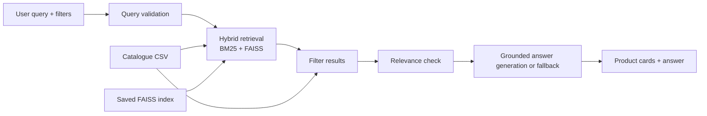

# Ecommerce Product Discovery RAG

This project is an interview-ready ecommerce product discovery application built on a local RAG pipeline. It combines BM25 keyword retrieval, FAISS semantic search, deterministic catalogue filtering, and a grounded answer path that uses only retrieved records from the catalogue.

## Objective

The application helps a user search a product catalogue with natural-language queries and structured constraints such as price and category. It returns product cards and a concise answer grounded in the actual catalogue, without inventing unavailable products, ratings, stock, or compatibility claims.

## Architecture



## Repository structure

- src/data_loader.py: loads and validates the processed catalogue.
- src/embeddings.py: product-document construction and embedding model use.
- src/vector_store.py: FAISS index build and search logic.
- src/hybrid_search.py: BM25 and reciprocal-rank fusion pipeline.
- src/filters.py: deterministic metadata filters.
- src/rag_pipeline.py: query validation and grounded answer logic.
- src/search_saved_index.py: validates the saved index and runs the hybrid retrieval CLI.
- src/build_index.py: recreates the persistent FAISS index.
- src/evaluation.py: evaluation helpers for Retrieval metrics.
- src/latency.py: latency tracking for pipeline stages.
- app.py: Streamlit product-discovery interface.
- data/processed/products.csv: cleaned local product catalogue.
- data/index/: persisted FAISS index and metadata.
- tests/: project regression tests.

## Data source and limitations

The project uses the processed Amazon-style product catalogue in data/processed/products.csv. The source file is produced from a dataset source recorded in data/processed/SOURCE.txt. The raw dataset is stored under data/raw/amazon_products.csv, and the processing script intentionally keeps only the verified available fields. Brand metadata is not present as a reliable verified column, so brand filtering is only enabled when the dataset actually contains brand values.

Known limitations:

- The catalogue is a local demo dataset and not a complete retailer catalog.
- Product descriptions are source text and should be treated as untrusted user content.
- The processed dataset contains missing prices and missing or Uncategorized category values, and the app handles those honestly.
- Free local generation is optional and may not run on constrained machines.

## Creating or rebuilding the index

From the project root:

```bash
python -m src.build_index
```

This creates or refreshes the files in data/index/ and validates the current embedding model and vector dimension. The multilingual embedding model supports cross-language product search in 50 languages; its weights are downloaded the first time it is used. Rebuild the index whenever the embedding model changes.

## Running the app locally

1. Create or activate a virtual environment.
2. Install dependencies:

```bash
python -m pip install -r requirements.txt
```

3. Start the app:

```bash
streamlit run app.py
```

## Testing

Run the full suite:

```bash
pytest -q
```

## Retrieval evaluation

The repo includes manually reviewed relevance labels in data/evaluation_queries.json. Run a simple retrieval evaluation from Python:

```bash
python - <<'PY'
from src.embeddings import load_embedding_model
from src.evaluation import evaluate_retrieval
from src.hybrid_search import build_bm25_index
from src.search_saved_index import load_saved_index, search_products

products, index, _ = load_saved_index()
model = load_embedding_model()
documents = [
    f"{row.get('name', '')} {row.get('description', '')} "
    f"{row.get('category', '')} {row.get('subcategory', '')}"
    for _, row in products.iterrows()
]
bm25 = build_bm25_index(documents)

def search(query: str):
    return [
        result["product_id"]
        for result in search_products(
            query, products, index, model, bm25_index=bm25, top_k=5
        )
    ]

print(evaluate_retrieval(search, "data/evaluation_queries.json", k=5)["summary"])
PY
```

This is a lightweight baseline and not a statement of universal benchmark quality. Relevance labels are limited to the actual catalogue.

## Benchmarking latency

The project includes latency helpers in src/latency.py. A reproducible benchmark can be run with:

```bash
python - <<'PY'
from src.data_loader import load_products
from src.embeddings import load_embedding_model
from src.hybrid_search import build_bm25_index
from src.latency import benchmark_search_pipeline, summarize_latencies
from src.search_saved_index import load_saved_index

products, index, _ = load_saved_index()
model = load_embedding_model()
query = "longboard skateboard"
documents = [f"{row.get('name', '')} {row.get('description', '')}" for _, row in products.iterrows()]
bm25 = build_bm25_index(documents)

samples = [benchmark_search_pipeline(query, products, index, model, bm25, filters={"max_price": 300}, top_k=5)]
print(samples)
print(summarize_latencies(samples))
PY
```

The latency counters measure initialization, query embedding, BM25 retrieval, FAISS retrieval, filtering, generation, and total request time using time.perf_counter(). p50 and p95 values should be computed only from measured data from the benchmark run.

## Model choices

- Embeddings: sentence-transformers/paraphrase-multilingual-MiniLM-L12-v2 (cross-lingual retrieval across 50 languages)
- Retrieval: BM25 + FAISS semantic retrieval using reciprocal-rank fusion
- Generation: optional local model via transformers, disabled by default; the app uses a deterministic grounded answer without requiring a hosted API

The saved index metadata is validated against the model, catalogue, product order, and product text before use. Rebuild the index whenever the embedding model or processed catalogue changes.

## Guardrails and security

- The user query is validated to reject empty, malformed, and injection-like inputs.
- Product text is treated as untrusted data.
- The application does not execute code or tools from retrieved product text.
- Generated text is not allowed to claim unsupported values such as availability, stock, compatibility, or discounts.
- If generation is unavailable or fails, the app returns a deterministic grounded fallback that cites the retrieved catalogue records without inventing new claims.
- No implementation can guarantee full injection resistance against every future prompt pattern, but the project uses explicit validation and deterministic logic to reduce risk.

## Deployment

The application is designed to run on a local developer machine and is also suitable as a lightweight Streamlit deployment target.

Local text generation is opt-in. Set `ENABLE_LOCAL_GENERATION=true` to download and run the optional FLAN-T5 model; without it, the application uses the deterministic grounded response and avoids the additional model download and memory use.

### Hosting a shareable Streamlit app

The app needs the processed catalogue and all three saved index artifacts in the repository. In particular, keep `data/index/products.faiss` included; the app cannot serve searches without it. The raw source CSV and local `.venv` are not required for hosting.

To publish the app with Streamlit Community Cloud:

1. Push this project directory to a GitHub repository.
2. In Streamlit Community Cloud, create an app from that repository and select `app.py` as the main file.
3. Deploy and share the app URL with users in other locations.

The first cold start downloads the multilingual sentence-transformer model. Streamlit caches the model and index per running app instance, but a restart or sleeping app can require a new model download. The deployed app uses local CPU inference and does not require API keys.

### Hosting a shareable Streamlit app

The app needs the processed catalogue and all three saved index artifacts in the repository. In particular, keep `data/index/products.faiss` included; the app cannot serve searches without it. The raw source CSV and local `.venv` are not required for hosting.

To publish the app with Streamlit Community Cloud:

1. Push this project directory to a GitHub repository.
2. In Streamlit Community Cloud, create an app from that repository and select `app.py` as the main file.
3. Deploy and share the public app URL with users in other locations.

The first cold start downloads the multilingual sentence-transformer model. Streamlit caches the model and index per running app instance, but a restart or sleeping app can require a new model download. The deployed app uses local CPU inference and does not require API keys.

## Known deployment caveats

- Local generation can be too heavy for small deployment instances.
- The saved index and dataset are not large enough to require exotic infrastructure.
- Free local models may be slower than hosted APIs, but they keep the core product discovery workflow offline and local.

## Additional notes

- The project does not commit generated model weights, secrets, or virtual environments.
- .gitignore excludes common local artifacts and environment files.
- The dataset attribution and source caveats live in data/processed/SOURCE.txt.
